  

<!-- assets/profile.svg is regenerated daily by .github/workflows/profile-svg.yml
     (text, pills and featured repos: .github/profile/config.json) -->

  

  
  
  

## 🛡️ About me

- 🔵 I work on **blue team** operations: monitoring, detection and incident response
- ☁️ I secure **cloud and Linux** infrastructure, with a focus on AWS
- 🧰 I build SOC labs with **Wazuh, MISP, TheHive, Cortex and Shuffle**
- 🌱 **Currently learning:**
  - Detection engineering: Wazuh/Sigma rules, MITRE ATT&CK mapping
  - SOAR & automation: Shuffle, TheHive, Cortex, Python playbooks
  - Cloud security (AWS): IAM, GuardDuty, CloudTrail, hardening
  - Threat intel & DFIR: MISP, threat hunting, incident response
- 📫 Reach me on [LinkedIn](https://www.linkedin.com/in/selikemab)

## 🏅 Certifications

<!-- Filled automatically by .github/workflows/credly-badges.yml from your Credly profile. -->
<!--START_SECTION:credly-->

  
  
  
  
  
  
  
  
  
  

<a href="https://www.credly.com/users/selikemab/badges">View all on Credly</a>

<!--END_SECTION:credly-->
